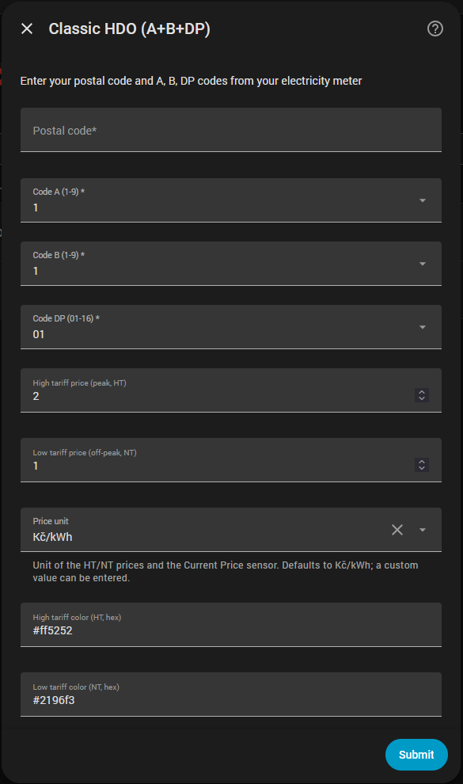
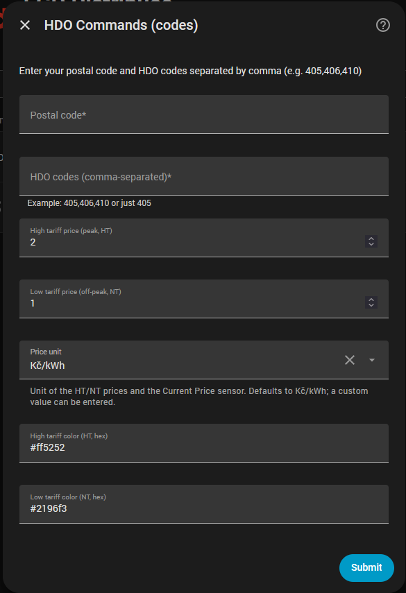
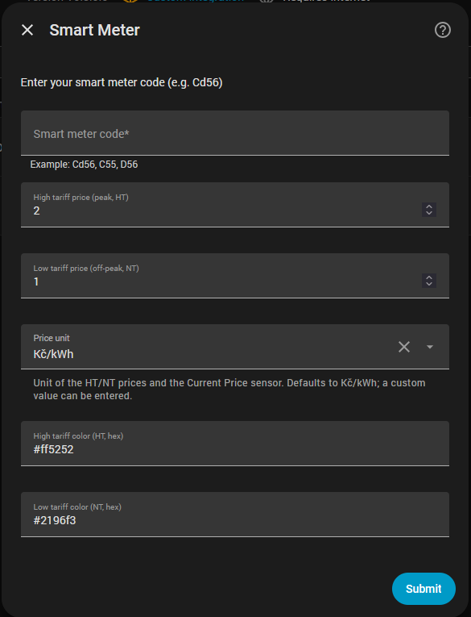
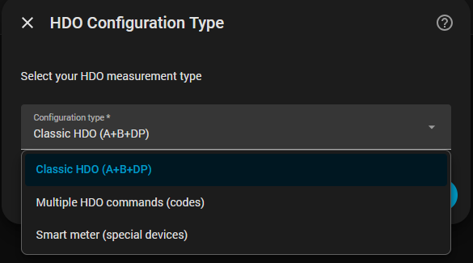

> 🇨🇿 **Český popis najdete zde: [README.md](README.md)**

# EGD Distribuce - Home Assistant Sensor

[](https://github.com/custom-components/hacs)

A Home Assistant integration that downloads **HDO (Hromadné dálkové ovládání – ripple control)** data from the **EG.D Distribuce** API.  
It lets you track the periods of **low (NT)** and **high tariff (VT)** electricity in the Czech Republic.

The integration supports both **classic electricity meters** and **smart meters**, and is fully configurable through the **Home Assistant graphical interface (GUI)**.

---

## Features

- Configuration via GUI (no YAML needed)
- Modern async architecture (DataUpdateCoordinator)
- Automatic data updates
- Support for multiple HDO measurement types
- Support for classic and smart electricity meters
- Detailed attributes for automations and graphs
- Validation of the entered postal code (PSČ) and HDO codes
- HDO Timeline - a simple graph card
- Configurable VT/NT prices, price unit and tariff colors (also changeable later in the integration **Settings**)

### Entities

| Entity | Name | Description |
|---|---|---|
| Binary sensor | **HDO Status** | Current HDO state (low tariff NT on/off), attributes with times, prices, region and `HDO_HOURLY` |
| Binary sensor | **HDO Times Change** | On if tomorrow's HDO times differ from today's |
| Binary sensor | **API update status** | On if the data was freshly downloaded from the API (attribute `status`: `online`/`cache`/`offline`, `last_update`) |
| Sensor | **Current Price** | Current electricity price based on the tariff (VT/NT) |
| Sensor | **Next HDO Change** | Timestamp of the next tariff change (the frontend shows a countdown) |
| Sensor | **Next HDO Slot** | Next HDO time slot |
| Button | **Refresh API data** | Download data from the API immediately |

### IDs of new entities

Newly registered entities use `<platform>.egd_<type>_<name>`.
The fixed part comes first; the name at the end is the integration config entry
title, lowercased with accents removed and spaces/separators replaced by underscores.
A leading "EGD HDO" from the default title is dropped so it is not repeated
("EGD HDO Smart (ACd253)" → `binary_sensor.egd_hdo_status_smart_acd253`).
For example, for an entry titled "Dům":

| Entity | New `entity_id` |
|---|---|
| HDO Status | `binary_sensor.egd_hdo_status_dum` |
| HDO Times Change | `binary_sensor.egd_hdo_times_change_dum` |
| API update status | `binary_sensor.egd_update_status_dum` |
| Current Price | `sensor.egd_current_price_dum` |
| Next HDO Change | `sensor.egd_next_hdo_change_dum` |
| Next HDO Slot | `sensor.egd_next_change_dum` |
| Refresh API data | `button.egd_refresh_api_dum` |

Existing entities are not renamed: their `entity_id`, `unique_id` and user
settings are preserved, without duplicates. The new format also applies to
entities first created on existing devices. Display names remain translated.
Home Assistant resolves ID collisions with numeric suffixes (e.g. `_2`).
Renaming the config entry does not change registered IDs. Users can still
manually change IDs, so parsers must also allow legacy and custom IDs.

Do not remove the integration to get the new format. Removing and adding it
again creates a new registration and may not preserve the old IDs.

---

## Supported HDO types

### 1. Classic HDO (A+B+DP)
For traditional electricity meters using a combination of **A**, **B** and **DP** codes. You enter the postal code, code A (1-9), code B (1-9) and code DP (01-16).

For classic HDO, public holidays follow the weekend schedule. For smart commands they follow the actual weekday, so a holiday on a Wednesday uses the Wednesday times.



### 2. Multiple HDO commands (codes)
For electricity meters with multiple HDO commands (e.g. different relays for water heating, space heating, etc.). You enter the postal code and HDO codes separated by a comma (e.g. `405,406,410`).




### 3. Smart meter (special devices)
Smart meters with special codes (ACd4510, Cd56, Cd2526_3, etc.).
The code is selected from a list that the integration downloads from https://hdo.distribuce24.cz/casy. You can type into the field to filter the list. Letter case does not matter and a non-existent code is rejected. Some meters show a hyphen instead of an underscore: look up code `CD2526-3` in the list as `Cd2526_3`. If the list cannot be downloaded, the setup is aborted and can be repeated later.

The setup has three screens: configuration type, selection of the smart meter code from the list, and settings (relay schedule, prices, unit, colors). The schedule field is shown only for codes that contain separate schedules for multiple relays (for example `ACd4510`: relay 1 – PV and relay 2 – TUV). The selected schedule is used for the attributes, the HDO state and the price; schedules are not combined. The schedule labelled **PV** is preselected (otherwise the first relay).

Older setups without a saved schedule use the same default rule (PV, otherwise the first relay) and Home Assistant shows a warning in Repairs. The schedule of an existing entry cannot be changed yet – remove the integration and add it again. The same warning is shown if EG.D no longer offers the saved schedule.




The screenshot shows the older form; the current code and schedule selection
steps are described above.

---

## Data updates

- **Automatic updates** - The HDO schedule is downloaded from the API once an hour (the interval is fixed, constant `API_UPDATE_INTERVAL` in `coordinator.py`). The HDO state switches exactly at the moment of change, without regular polling. When the API is unavailable, the cache is used and a new download is attempted after 5 minutes. Data can be downloaded immediately with the **Refresh API data** button.
- **Detailed attributes** - Times for today/tomorrow, starts, ends, region, prices.
- **Data validation** - Automatic validation of the postal code (PSČ) and HDO codes.

---

## Installation

### Option 1: Via HACS (recommended)
1. Make sure [HACS](https://hacs.xyz/) is installed

2. Go to HACS → Integrations

3. Click the menu (⋮) in the top right → Custom repositories

4. Add this URL: `https://github.com/Antrac1t/HomeAssistant-EGDdistribuce`

5. Click Install.

6. Restart Home Assistant


### Option 2: Manual
1. Download the latest release

2. Copy the `custom_components/egddistribuce` folder to your `config/custom_components/` folder

3. Restart Home Assistant


## Configuration

1. Go to **Settings** → **Devices & services**

2. Click **+ Add integration**

3. Search for "**EGD Distribuce**"

4. **Select the configuration type:**   


5. Enter the required data (postal code, A/B/DP codes or HDO codes); for a smart meter, select a code from the list and a relay schedule if offered. Optionally set VT/NT prices, price unit and tariff colors. Prices, unit and colors can be changed later in the integration **Settings**.


## HDO Timeline setup

New and edited dashboards must use the new type `custom:egd-hdo-card`. The old type `custom:hdo-chart-card` remains supported only as a compatibility alias for existing dashboards; switch to the new type when editing them.


The integration loads the card automatically, there is no need to add it to **Resources**. Just add the card to a dashboard:

```yaml
type: custom:egd-hdo-card
entity: binary_sensor.egd_hdo_status_dum # replace with your actual HDO Status entity ID
title: HDO Timeline
show_days: 2
show_header: false
```

Card texts are translated according to the Home Assistant language. Translations are located in `custom_components/egddistribuce/hdo_card_translations/<language>.json` (currently `cs` and `en`, other languages fall back to English). To add a new language, just add another file.

---

## Examples

### Graph with other entities

You can show HDO in a graph with other entities, for example spot prices from Czech Energy Spot Prices (https://github.com/rnovacek/homeassistant_cz_energy_spot_prices):


```yaml
type: custom:apexcharts-card
graph_span: 2d
span:
  start: day
stacked: true
apex_config:
  legend:
    show: false
  yaxis:
    tickAmount: 16
    max: 8
all_series_config:
  type: column
now:
  show: true
  label: Now
header:
  show: true
  show_states: true
series:
  - entity: binary_sensor.egd_hdo_status_dum # replace with your actual HDO Status entity ID
    float_precision: 2
    group_by:
      func: avg
      duration: 1hour
    show:
      in_header: before_now
    unit: Kč/kWh
    data_generator: >
      return  Object.entries(entity.attributes.HDO_HOURLY).map(([date, value],
      index) => {
        return [new Date(date).getTime(), value];
      });
  - entity: sensor.current_spot_electricity_price
    float_precision: 2
    show:
      in_header: before_now
    data_generator: |
      return Object.entries(entity.attributes).map(([date, value], index) => {
        return [new Date(date).getTime(), (value + 0.35 + 0.028 + 0.114 )* 1.21];
      });
```

Spot prices are (at the moment) hourly, but HDO can have 15-minute intervals. For the graph to work well, both entities must have the same interval duration – the `group_by` function takes care of it. In this example it groups by 1 hour, which works well for me. In your case, `30minutes` or even `15minutes` might be required.

### Time of the next HDO change

Time of the next HDO change on the dashboard (the frontend renders it as a live relative time, e.g. "in 23 minutes"):
```yaml
  - entity: sensor.egd_next_hdo_change_dum # replace with your actual Next HDO Change entity ID
    name: Next change
    format: relative
```

The `Time Until Change` sensor and the `remaining_time` attribute were removed (they changed every minute and flooded the logbook). Use the **Next HDO Change** timestamp sensor. It can also trigger an automation exactly at the moment of the switch:
```yaml
trigger:
  - trigger: time
    at: sensor.egd_next_hdo_change_dum
```

---

## References

- PRE Distribuce - Home Assistant Sensor (https://github.com/slesinger/HomeAssistant-PREdistribuce)
- CEZ Distribuce - Home Assistant Sensor (https://github.com/Cmajda/ha_cez_distribuce)
