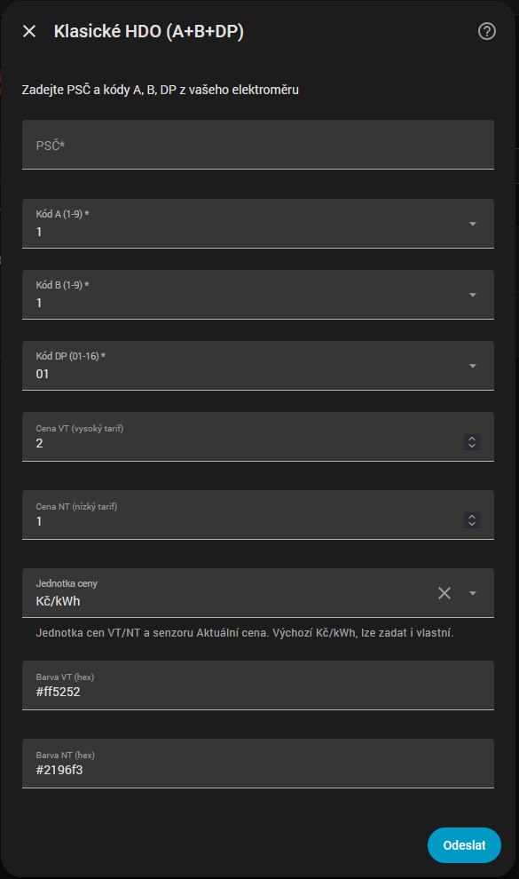
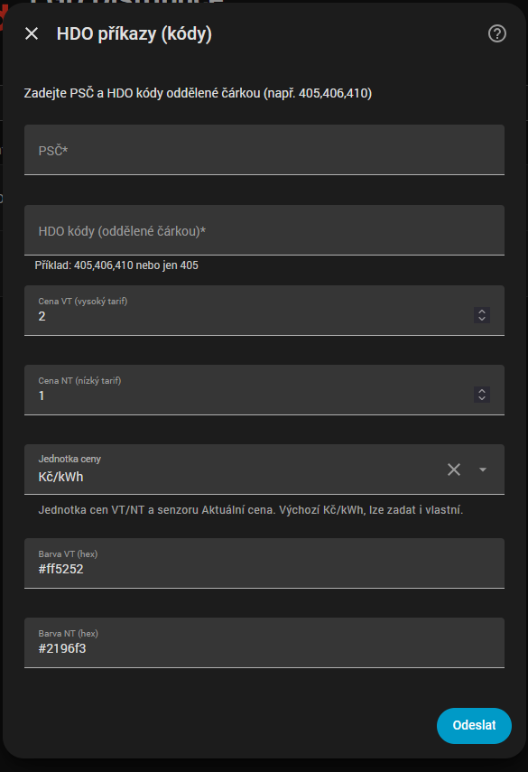
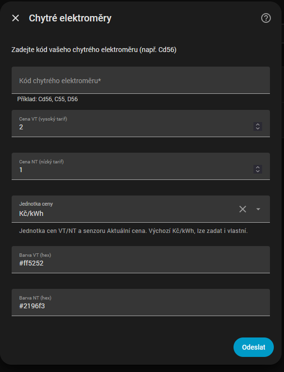
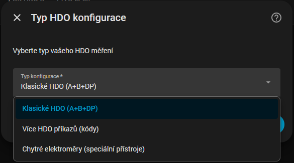

> 🇬🇧 **English description can be found here: [README.en.md](README.en.md)**

# EGD Distribuce - Home Assistant Sensor

[](https://github.com/custom-components/hacs)

Integrace pro Home Assistant sloužící ke stahování **HDO (Hromadné dálkové ovládání)** dat z API **EG.D Distribuce**.  
Umožňuje sledovat období **nízkého (NT)** a **vysokého tarifu (VT)** elektřiny v České republice.

Integrace podporuje jak **klasické elektroměry**, tak **chytré elektroměry**, a je plně konfigurovatelná přes **grafické rozhraní Home Assistantu (GUI)**.

---

## Funkce

- Konfigurace přes GUI (není potřeba YAML)
- Moderní async architektura (DataUpdateCoordinator)
- Automatická aktualizace dat
- Podpora více typů HDO měření
- Podpora klasických i chytrých elektroměrů
- Detailní atributy pro automatizace a grafy
- Validace zadaných PSČ a HDO kódů
- HDO Timeline - zobrazení jednoduchého grafu
- Nastavitelné ceny VT/NT, jednotka ceny a barvy tarifů (i dodatečně v **Nastavení** integrace)

### Entity

| Entita | Název | Popis |
|---|---|---|
| Binární senzor | **HDO stav** | Aktuální stav HDO (nízký tarif NT zapnutý/vypnutý), atributy s časy, cenami, regionem a `HDO_HOURLY` |
| Binární senzor | **Změna HDO časů** | Zapnutý, pokud se zítřejší HDO časy liší od dnešních |
| Binární senzor | **Stav aktualizace API** | Zapnutý, pokud jsou data čerstvě stažená z API (atributy `status`: `online`/`cache`/`offline`, `last_update`) |
| Senzor | **Aktuální cena** | Aktuální cena elektřiny podle tarifu (VT/NT) |
| Senzor | **Další změna HDO** | Časové razítko příští změny tarifu (frontend zobrazí odpočet) |
| Senzor | **Další HDO čas** | Příští HDO časový slot |
| Tlačítko | **Obnovit data z API** | Okamžité stažení dat z API |

### ID nových entit

Nově registrované entity používají formát `<platforma>.egd_<typ>_<nazev>`.
Pevná část je na začátku; `nazev` na konci je název konfiguračního záznamu integrace
převedený na malá písmena bez diakritiky, mezery a oddělovače se změní na podtržítka.
Úvodní „EGD HDO“ z výchozího názvu se vynechává, aby se neopakovalo
(„EGD HDO Smart (ACd253)“ → `binary_sensor.egd_hdo_status_smart_acd253`).
Například pro záznam „Dům“:

| Entita | Nové `entity_id` |
|---|---|
| HDO stav | `binary_sensor.egd_hdo_status_dum` |
| Změna HDO časů | `binary_sensor.egd_hdo_times_change_dum` |
| Stav aktualizace API | `binary_sensor.egd_update_status_dum` |
| Aktuální cena | `sensor.egd_current_price_dum` |
| Další změna HDO | `sensor.egd_next_hdo_change_dum` |
| Další HDO čas | `sensor.egd_next_change_dum` |
| Obnovit data z API | `button.egd_refresh_api_dum` |

Existující entity se nepřejmenovávají: `entity_id`, `unique_id` i uživatelská
nastavení zůstávají zachována, bez duplicit. Nový formát platí i pro dosud
nevytvořené entity u stávajícího zařízení. Zobrazované názvy zůstávají přeložené.
Při kolizi ID přidá Home Assistant číselný konec (např. `_2`).
Přejmenování záznamu nezmění již registrovaná ID. Uživatel může ID stále ručně
změnit; parsování proto musí počítat i se starými a vlastními ID.

Integraci kvůli novému formátu neodebírejte. Odebrání a opětovné přidání znamená
novou registraci; původní ID se tím nemusí zachovat.

---

## Podporované typy HDO

### 1. Klasické HDO (A+B+DP)
Určeno pro tradiční elektroměry využívající kombinaci kódů **A**, **B** a **DP**. Zadáváte PSČ, kód A (1-9), kód B (1-9) a kód DP (01-16).

U klasického HDO se státní svátky řídí víkendovým rozpisem. U smart povelů se řídí skutečným dnem v týdnu, takže svátek ve středu použije středeční časy.




### 2. Více HDO příkazů (kódy)
Pro elektroměry s více HDO příkazy (např. různá relé pro ohřev vody, topení, atd.). Zadáváte PSČ a HDO kódy oddělené čárkou (např. `405,406,410`).




### 3. Chytré elektroměry (speciální přístroje)
Chytré měřiče se speciálními kódy (ACd4510, Cd56, Cd2526_3, atd.).
Kód se vybírá ze seznamu, který integrace stáhne z https://hdo.distribuce24.cz/casy. Do pole lze psát, seznam se tím filtruje. Na velikosti písmen nezáleží, neexistující kód se odmítne. Některé elektroměry zobrazují pomlčku místo podtržítka: kód `CD2526-3` hledejte v seznamu jako `Cd2526_3`. Pokud se seznam nepodaří stáhnout, nastavení se přeruší a lze ho zopakovat později.

Nastavení má tři obrazovky: typ konfigurace, výběr kódu smart metru ze seznamu a nastavení (rozpis relé, ceny, jednotka, barvy). Pole s rozpisem se zobrazí jen u kódů, které obsahují samostatné rozpisy pro více relé (například `ACd4510`: relé 1 – PV a relé 2 – TUV). Vybraný rozpis se použije pro atributy, stav HDO i cenu; rozpisy se nesčítají. Předvybrán je rozpis označený **PV** (jinak první relé).

Starší nastavení bez uloženého rozpisu používá stejné výchozí pravidlo (PV, jinak první relé) a Home Assistant zobrazí upozornění v Opravách. Rozpis stávajícího záznamu zatím nelze změnit – integraci odeberte a přidejte znovu. Stejné upozornění se zobrazí, pokud EG.D už uložený rozpis nenabízí.




Obrázek zachycuje starší formulář; aktuální výběr kódu a rozpisu popisují kroky výše.

---

## Aktualizace dat

- **Automatická aktualizace** - HDO rozvrh se stahuje z API jednou za hodinu (interval je pevný, v `coordinator.py` konstanta `API_UPDATE_INTERVAL`). Stav HDO se přepíná přesně v okamžiku změny, bez pravidelného dotazování. Při výpadku API se použije cache a za 5 minut se zkusí nové stažení. Data lze stáhnout ihned tlačítkem **Obnovit data z API**.
- **Detailní atributy** - Časy dnes/zítra, začátky, konce, region, ceny.
- **Validace dat** - Automatické ověření platnosti PSČ a HDO kódů.

---

## Instalace

### Možnost 1: Přes HACS (doporučeno)
1. Ujistěte se, že máte nainstalovaný [HACS](https://hacs.xyz/)

2. Jděte do HACS → Integrace

3. Klikněte na menu (⋮) vpravo nahoře → Vlastní repozitáře

4. Přidejte tuto URL: `https://github.com/Antrac1t/HomeAssistant-EGDdistribuce`

5. Klikněte Instalovat.

6. Restartujte Home Assistant


### Možnost 2: Manuálně
1. Stáhněte nejnovější release

2. Zkopírujte složku `custom_components/egddistribuce` do vaší složky `config/custom_components/`

3. Restartujte Home Assistant


## Konfigurace

1. Jděte na **Nastavení** → **Zařízení a služby**

2. Klikněte **+ Přidat integraci**

3. Vyhledejte "**EGD Distribuce**"

4. **Vyberte typ konfigurace:**   


5. Zadejte požadované údaje (PSČ, kódy A/B/DP nebo HDO kódy); u chytrého elektroměru vyberte kód ze seznamu a případně rozpis relé. Nastavte volitelně ceny VT/NT, jednotku ceny a barvy tarifů. Ceny, jednotku i barvy lze později změnit v **Nastavení** integrace.


## HDO Timeline nastavení

Nové i upravované dashboardy musí používat nový typ `custom:egd-hdo-card`. Starý typ `custom:hdo-chart-card` zůstává podporovaný pouze jako kompatibilní alias pro existující dashboardy; při jejich úpravě přejděte na nový typ.


Integrace kartu načítá automaticky, do **Zdrojů** ji není potřeba přidávat. Kartu stačí přidat do dashboardu:

```yaml
type: custom:egd-hdo-card
entity: binary_sensor.egd_hdo_status_dum # nahraďte skutečným ID senzoru HDO stav
title: HDO Timeline
show_days: 2
show_header: false
```

Texty karty se překládají podle jazyka Home Assistantu. Překlady jsou v `custom_components/egddistribuce/hdo_card_translations/<jazyk>.json` (zatím `cs` a `en`, ostatní jazyky použijí angličtinu). Nový jazyk stačí přidat jako další soubor.

---

## Příklady

### Graf s dalšími entitami

HDO lze zobrazit v grafu spolu s dalšími entitami, například se spotovými cenami z integrace Czech Energy Spot Prices (https://github.com/rnovacek/homeassistant_cz_energy_spot_prices):


```yaml
type: custom:apexcharts-card
graph_span: 2d
span:
  start: day
stacked: true
apex_config:
  legend:
    show: false
  yaxis:
    tickAmount: 16
    max: 8
all_series_config:
  type: column
now:
  show: true
  label: Nyní
header:
  show: true
  show_states: true
series:
  - entity: binary_sensor.egd_hdo_status_dum # nahraďte skutečným ID senzoru HDO stav
    float_precision: 2
    group_by:
      func: avg
      duration: 1hour
    show:
      in_header: before_now
    unit: Kč/kWh
    data_generator: >
      return  Object.entries(entity.attributes.HDO_HOURLY).map(([date, value],
      index) => {
        return [new Date(date).getTime(), value];
      });
  - entity: sensor.current_spot_electricity_price
    float_precision: 2
    show:
      in_header: before_now
    data_generator: |
      return Object.entries(entity.attributes).map(([date, value], index) => {
        return [new Date(date).getTime(), (value + 0.35 + 0.028 + 0.114 )* 1.21];
      });
```

Spotové ceny jsou (zatím) hodinové, ale HDO může mít 15minutové intervaly. Aby graf fungoval dobře, musí mít obě entity stejnou délku intervalu – o to se stará funkce `group_by`. V tomto příkladu se seskupuje po 1 hodině, což mi dobře vyhovuje. Ve vašem případě může být potřeba `30minutes` nebo i `15minutes`.

### Čas příští změny HDO

Čas příští změny HDO na dashboardu (frontend ho zobrazí jako živý relativní čas, např. „za 23 minut“):
```yaml
  - entity: sensor.egd_next_hdo_change_dum # nahraďte skutečným ID senzoru Další změna HDO
    name: Další změna
    format: relative
```

Senzor „Zbývající čas do změny“ (`Time Until Change`) a atribut `remaining_time` byly odstraněny (měnily se každou minutu a zaplňovaly logbook). Použijte timestamp senzor **Další změna HDO**. Dá se s ním spouštět i automatizace přesně v okamžiku přepnutí:
```yaml
trigger:
  - trigger: time
    at: sensor.egd_next_hdo_change_dum
```

---

## Odkazy

- PRE Distribuce - Home Assistant Sensor (https://github.com/slesinger/HomeAssistant-PREdistribuce)
- CEZ Distribuce - Home Assistant Sensor (https://github.com/Cmajda/ha_cez_distribuce)
