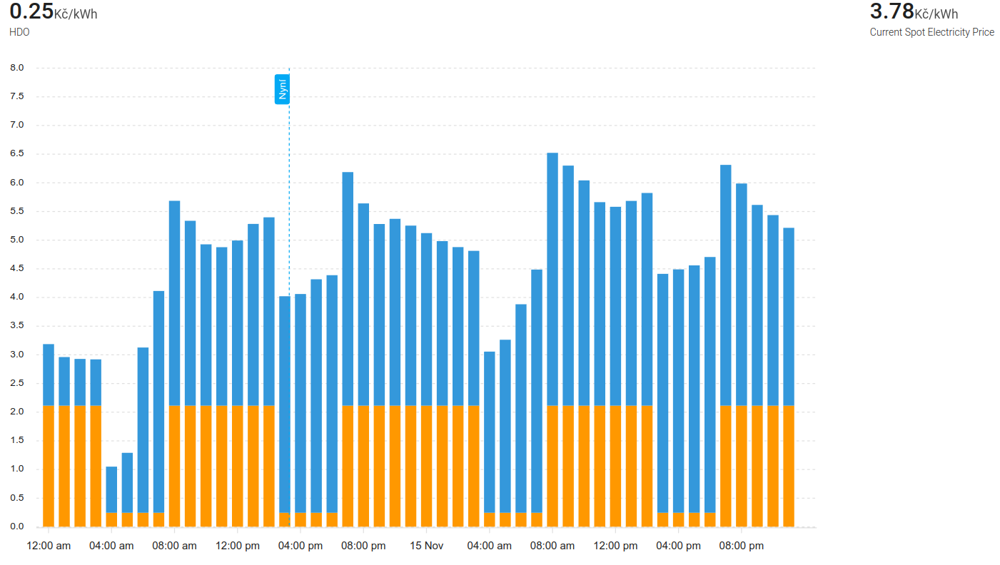

# EGD Distribuce - Home Assistant Sensor

[](https://github.com/custom-components/hacs)

Integrace pro Home Assistant sloužící ke stahování **HDO (Hromadné dálkové ovládání)** dat z API **EG.D Distribuce**.  
Umožňuje sledovat období **nízkého (NT)** a **vysokého tarifu (VT)** elektřiny v České republice.

Integrace podporuje jak **klasické elektroměry**, tak **smart měření**, a je plně konfigurovatelná přes **grafické rozhraní Home Assistantu (GUI)**.

---

## Funkce

- Konfigurace přes GUI (není potřeba YAML)
- Moderní async architektura (DataUpdateCoordinator)
- Automatická aktualizace dat
- Podpora více typů HDO měření
- Podpora klasických i smart elektroměrů
- Detailní atributy pro automatizace a grafy
- Validace zadaných PSČ a HDO kódů
- HDO Timeline - zobrazení jednoduchého grafu

---

## Podporované typy HDO

### 1. Klasické HDO (A + B + DP)
Určeno pro tradiční elektroměry využívající kombinaci kódů **A**, **B** a **DP**.


### 2. HDO Povel 
Pro elektroměry s více HDO příkazy (např. různá relé pro ohřev vody, topení, atd.)


### 3. Smart Metr
Chytré měřiče s speciálními kódy (Cd56, C55, D56, atd.). 
Záleží na velikosti písmen a některé elektroměry mohou zobrazovat pomlčku míso podtržítka (na el. je toto: CD2526-3).
Zadávaný kód musí odpovídat formátu v https://hdo.distribuce24.cz/casy (výsledný kód je Cd2526_3)

###


###


## 🎯 Funkce
  - Aktuální cena elektřiny

  - Čas příští změny tarifu (timestamp sensor, frontend zobrazí odpočet)

  - Příští HDO časový slot## Installation

-  Automatické Aktualizace - HDO rozvrh se stahuje z API jednou za hodinu (interval je pevný, v `coordinator.py` konstanta `API_UPDATE_INTERVAL`). Stav HDO se přepíná přesně v okamžiku změny, bez pravidelného dotazování. Při výpadku API se použije cache a za 5 minut se zkusí nové stažení. Data lze stáhnout ihned tlačítkem **Obnovit data z API**.

-  Detailní Atributy - Časy dnes/zítra, začátky, konce, region, ceny

-  Validace Dat - Automatické ověření platnosti PSČ a HDO kódů


## Instalace

### Možnost 1: Přes HACS (Doporučeno)
1. Ujistěte se, že máte nainstalovaný [HACS](https://hacs.xyz/)

2. Jděte do HACS → Integrace

3. Klikněte na menu (⋮) vpravo nahoře → Vlastní repozitáře

4. Přidejte tuto URL: `https://github.com/Antrac1t/HomeAssistant-EGDdistribuce`

5. Klikněte Instalovat.

6. Restartujte Home Assistant


### Možnost 2: Manuálně
1. Stáhněte nejnovější release

2. Zkopírujte složku `custom_components/egddistribuce` do vaší složky `config/custom_components/

3. Restartujte Home Assistant


##  Konfigurace

1. Jděte na **Nastavení** → **Zařízení a služby** 

2. Klikněte **+ Přidat integraci**   

3. Vyhledejte "**EGD Distribuce**" 

4. **Vyberte typ konfigurace:**   


##  HDO Timeline nastavení


```yaml
type: custom:egd-hdo-chart-card
entity: binary_sensor.NazevSenzoru
title: HDO Timeline
show_days: 2
show_header: false

```

Texty karty se překládají podle jazyka Home Assistantu. Překlady jsou v `custom_components/egddistribuce/hdo_card_translations/<jazyk>.json` (zatím `cs` a `en`, ostatní jazyky použijí angličtinu). Nový jazyk stačí přidat jako další soubor.


You can show them in a graph, with other entities, for example spot prices from Czech Energy Spot Prices (https://github.com/rnovacek/homeassistant_cz_energy_spot_prices):



```yaml
type: custom:apexcharts-card
graph_span: 2d
span:
  start: day
stacked: true
apex_config:
  legend:
    show: false
  yaxis:
    tickAmount: 16
    max: 8
all_series_config:
  type: column
now:
  show: true
  label: Nyní
header:
  show: true
  show_states: true
series:
  - entity: binary_sensor.egd_hdo_hdo_status # Depending how you named your device, find sensor *_hdo_status
    float_precision: 2
    group_by:
      func: avg
      duration: 1hour
    show:
      in_header: before_now
    unit: Kč/kWh
    data_generator: >
      return  Object.entries(entity.attributes.HDO_HOURLY).map(([date, value],
      index) => {
        return [new Date(date).getTime(), value];
      });
  - entity: sensor.current_spot_electricity_price
    float_precision: 2
    show:
      in_header: before_now
    data_generator: |
      return Object.entries(entity.attributes).map(([date, value], index) => {
        return [new Date(date).getTime(), (value + 0.35 + 0.028 + 0.114 )* 1.21];
      });
```

Since spot prices are (at the moment) hourly and HDO can be in 15 minute increments, for the graph to work well, both entities must have the same interval duration. Function `group_by` takes care of it. In this example it groups by 1 hour, because that works for me well. In your case, maybe `30minutes` or even `15minutes` might be equired.


Čas příští změny HDO na dashboardu (frontend ho zobrazí jako živý relativní čas, např. „za 23 minut“):
```yaml
  - entity: sensor.hdo_next_hdo_change # timestamp sensor, název závisí na pojmenování zařízení
    name: Další změna
    format: relative
```

Sensor `Time Until Change` a atribut `remaining_time` byly odstraněny (měnily se každou minutu a zaplňovaly logbook). Použijte timestamp sensor `Next HDO Change`. Dá se s ním spouštět i automatizace přesně v okamžiku přepnutí:
```yaml
trigger:
  - trigger: time
    at: sensor.hdo_next_hdo_change
```

### Step 3: Restart HA

For the newly added integration to be loaded, HA needs to be restarted.

## References

- PRE Distribuce - Home Assistant Sensor (https://github.com/slesinger/HomeAssistant-PREdistribuce)
- CEZ Distribuce - Home Assistant Sensor (https://github.com/zigul/HomeAssistant-CEZdistribuce)
